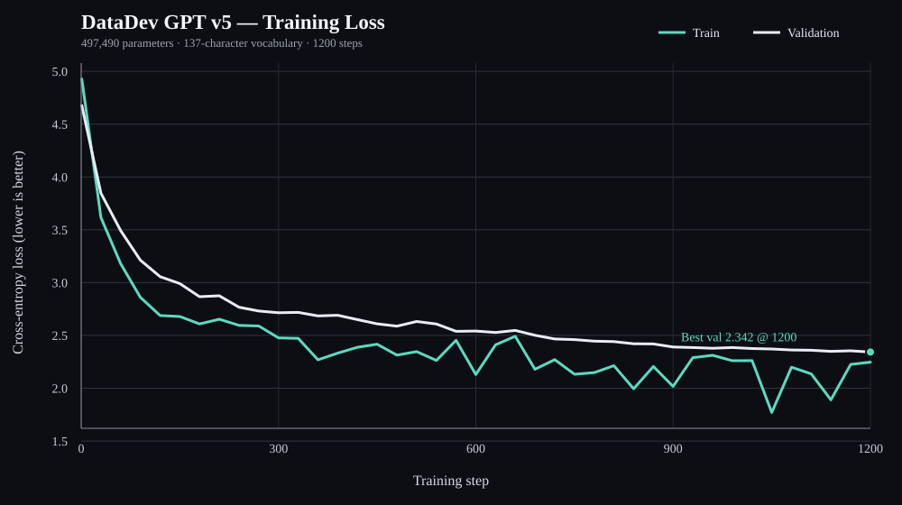

# DataDev GPT v5 — Training Report

- **Parameters:** 497,490
- **Architecture:** embedding 138, 6 attention heads, 2 transformer layers, context 128
- **Vocabulary:** 137 characters
- **Training steps completed:** 1,200 / 1,200
- **Best checkpoint step:** 1,200
- **Initial validation loss:** 4.6770
- **Best validation loss:** 2.3420
- **Final logged validation loss:** 2.3420
- **Final logged training loss:** 2.2470
- **Logged elapsed time:** 728.6 seconds
- **Checkpoint config best validation loss:** 2.3421124815940857

Validation loss measures next-character prediction on held-out text; lower is better. It does **not** by itself prove factual accuracy, reasoning quality, or conversational usefulness. The current model is a small character-level prototype.
